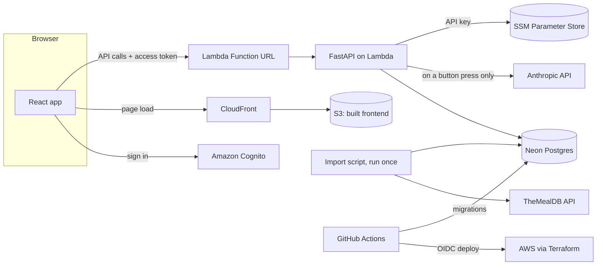

# Scrappy

[](https://github.com/hishitashah/Scrappy/actions/workflows/ci.yml)

**What can I actually make with what's in my kitchen right now?**

Scrappy is a desktop web app that ranks recipes by how many of their ingredients you already have. You type in your pantry, and every result tells you exactly what's missing: *"You have 3 of 7 — missing oil, salt, soy sauce, spring onion."*

Most recipe sites start from a recipe and send you shopping. Scrappy works backwards from what you've got.

## Live demo

**<https://d3co1qxd5fhw9l.cloudfront.net>**

It needs an account (email plus a verification code) and it's **desktop-only** — there's no mobile layout, by design. A cold start against a suspended database takes about five seconds; after that, requests are ~0.2s.

<!-- TODO(M9): record docs/demo.gif — ~20s, empty pantry → type four ingredients →
     results reorder → open a recipe → "Suggest substitutions" — then uncomment:

-->

## Features

| | Feature | What it does |
|---|---|---|
| F1 | Pantry editing | Add ingredients by typing, with autocomplete over the catalog and a "Did you mean…?" fallback; remove one with a click |
| F2 | Recipe matching | Recipes ranked by the percentage of their ingredients you have, in a single SQL query |
| F3 | Match transparency | Every result shows "You have 3 of 7" and names what's missing |
| F4 | Recipe detail | Three paged screens: photo and tags, ingredients with measurements and owned/missing marks, then numbered steps with video and source links |
| F5 | Accounts | Sign up, log in, log out, reset password. The whole app requires login |
| F6 | Saved pantry | Your pantry lives in the database and loads on sign-in |
| **F7** | **AI substitutions** 🤖 | For a recipe's missing ingredients, Claude suggests what to use instead, preferring things already in your pantry |
| **F8** | **AI recipe generation** 🤖 | When nothing matches, Claude writes a recipe from your exact pantry and saves it to your account, labelled and visible only to you |
| F9 | Grocery list | Add missing ingredients to a saved list, then open each one at your chosen supermarket's search |

## Architecture



- The **frontend** is a static React build served from a private S3 bucket through CloudFront.
- The **API** is FastAPI running on AWS Lambda (via Mangum), reached through a Lambda Function URL. It verifies the Cognito access token on every request.
- The **database** is Postgres on Neon's free plan. The recipe catalog is imported from TheMealDB once, so browsing never calls a third-party API.
- **Anthropic is the only runtime third-party call**, from the backend only, on an explicit button press — never on page load, and never from the browser. The API key lives in SSM Parameter Store and is read once per cold start.
- **Everything on AWS is defined in Terraform** and deployed by GitHub Actions on every merge to `main`.

## Tech stack

| Layer | Choice |
|---|---|
| Frontend | React 19, TypeScript (strict), Vite, React Router, TanStack Query 5, Tailwind CSS 4, Headless UI |
| Auth UI | Amplify UI `Authenticator` + `aws-amplify` 6 |
| API | Python 3.13, FastAPI, Pydantic 2, pydantic-settings, Mangum |
| AI features | `anthropic` SDK, Claude Opus 5.5 with structured outputs, backend only, hard $5/month cap |
| Database | PostgreSQL 18, SQLAlchemy 2, psycopg 3, Alembic |
| Auth | Amazon Cognito, PyJWT |
| Hosting | AWS Lambda, S3, CloudFront, SSM Parameter Store, CloudWatch; Neon Postgres |
| Infrastructure | Terraform |
| CI/CD | GitHub Actions with AWS access via OIDC (no long-lived keys) |
| Tooling | uv, ruff, pytest; Vitest, React Testing Library, MSW; Docker Compose |

## Testing

**410 tests** — 286 pytest, 124 Vitest — written alongside each feature rather than after it.

| Backend (pytest) | Tests | | Frontend (Vitest) | Tests |
|---|---:|---|---|---:|
| Ingredient normalization | 62 | | Ingredient filter & store URLs | 24 |
| AI features & spend guardrails | 69 | | Grocery list & add-to-list | 20 |
| API endpoints | 50 | | Recipe pages | 20 |
| Config, logging & schema | 36 | | Pantry editor & results | 22 |
| Matching & catalog import | 49 | | AI panels | 22 |
| Auth & token rejection | 20 | | Routing, HTTP & errors | 16 |
| **Total** | **286** | | **Total** | **124** |

**11 of the auth tests are invalid-token scenarios**: expired, wrong user pool, wrong app client, bad signature, an ID token used as an access token, a missing or malformed `Authorization` header, and a token missing required claims.

**Backend tests run against real Postgres**, not an in-memory stand-in, because the matching query uses Postgres-specific SQL. Each test runs inside a transaction that is rolled back, so tests never see each other's rows. **Frontend tests never reach the network:** MSW intercepts every request, with `onUnhandledRequest: 'error'` so an accidental call fails loudly instead of hanging. **No test calls Anthropic** — the client is injected, and tests supply their own.

Backend coverage is **97%**, reported but not enforced — a number to watch, not a threshold to game.

**CI** runs on every pull request and every push to `main`, in three parallel jobs:

| Job | Runs |
|---|---|
| **backend** | `ruff check`, `ruff format --check`, and `pytest --cov` against a Postgres 18 service container |
| **frontend** | `npm run lint`, `npm run typecheck`, `npm test`, `npm run build` |
| **infra** | `terraform fmt -check -recursive`, `init -backend=false`, `validate` |

`main` is protected: a pull request cannot merge until all three pass. The infra job needs no AWS credentials, because `-backend=false` skips the remote state entirely.

**Merging to `main` deploys**, in a fourth job that runs only after those three pass:

1. Assume an AWS role through GitHub's OIDC provider — **no AWS keys are stored in GitHub**, and the trust policy only accepts workflows running on `main` in this repository.
2. Build the Lambda package with the same script used locally.
3. Run database migrations against Neon, before the new code goes live.
4. `terraform apply`, which ships the new Lambda code along with any infrastructure change.
5. Smoke-test `/health` and assert the reported version equals the deployed commit — this is what catches "the deploy succeeded but the old code is still serving".
6. Upload the frontend: hashed assets first with a one-year cache, then `index.html` with `no-cache`, then invalidate CloudFront.

## Running cost

**Fixed monthly cost: $0.** The rule is that no resource may charge for merely existing, which rules out RDS, NAT Gateway, load balancers, EC2, public IPv4 addresses, Route 53 hosted zones and Secrets Manager. What's left runs inside free tiers: Lambda (1M requests/month), CloudFront (1 TB), Cognito (10,000 monthly active users), Neon (100 compute-hours, suspends after 5 minutes idle), and GitHub Actions (free on public repos). S3 storage for the frontend is fractions of a cent, and CloudWatch log retention is capped at 14 days.

**The one variable cost is the Anthropic API, capped at $5/month** by six guardrails:

1. **Usage ledger** — every call records its real token counts and cost.
2. **Monthly cap** — at 500¢, both AI endpoints return 503.
3. **Per-user daily limits** — 10 substitution requests and 3 generated recipes per user per day (429).
4. **Cache** — a repeat substitution request for the same recipe and pantry costs nothing.
5. **Kill switch** — `AI_ENABLED=false` disables both features without a deploy.
6. **Console limit** — a $5 spend limit on the API key itself, so a bug in our own accounting still can't produce a surprise bill.

A substitution costs **0.6¢**, measured rather than estimated: the first real call used 692 input and 148 output tokens, or 0.57¢. So $5 covers roughly 800 substitutions — orders of magnitude more than a portfolio demo will use. The cap exists for the runaway case, not the expected one. Every call is triggered by an explicit button press; nothing spends money on page load.

## Local setup

**Prerequisites:** macOS or Linux, [Docker Desktop](https://www.docker.com/products/docker-desktop/), and [uv](https://docs.astral.sh/uv/).

```bash
# 1. Start local Postgres 18 on host port 5433 (creates scrappy and scrappy_test)
docker compose up -d

# 2. Install backend dependencies and create a local config file
cd backend
uv sync
cp .env.example .env

# 3. Create the tables
uv run alembic upgrade head

# 4. Import the recipe catalog from TheMealDB (~11s; responses are cached)
uv run python -m scripts.import_mealdb

# 5. Run the API: http://127.0.0.1:8000, interactive docs at /docs
uv run uvicorn app.main:app --reload

# 6. Run tests, lint, and format checks
uv run pytest
uv run ruff check . && uv run ruff format --check .
```

Then the frontend, in a second terminal:

```bash
cd frontend
npm install --legacy-peer-deps   # see the note below
cp .env.example .env.local

npm run dev        # http://localhost:5173
npm test           # component and unit tests
npm run lint && npm run typecheck && npm run build
```

The AI features stay off locally until you set `AI_ENABLED=true` and an `ANTHROPIC_API_KEY` in `backend/.env`. Everything else — pantry, matching, recipes, the grocery list — works without a key, and the test suite never needs one.

The `--legacy-peer-deps` flag works around a peer-resolution crash in npm 10.9.2 (`Cannot read properties of null (reading 'edgesOut')`). npm 12 fixes it, and `npm ci`, which CI uses, is unaffected.

Stop the database with `docker compose down`; its data is kept in a Docker volume.

## Future Implementation

Deliberately out of the MVP, in rough order of appeal:

- **Favorites and cook history** — mark a recipe cooked, find the ones you liked again.
- **A multi-recipe shopping list** — everything missing across several chosen meals, merged and copyable as plain text, so one trip covers the week.
- **Dietary filters** and **expiry nudges**, the latter using `pantry_items.added_at`, which is already stored.
- **Personalization** from history and favorites.

## License

[MIT](LICENSE)
